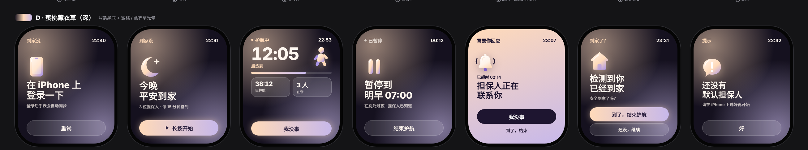

# 安全回家 · 设计说明

App 名：**安全回家**（工程、Bundle ID 仍叫 NightEscort）。口号：回家路上，有人一直在。

## 文件

| 文件 | 内容 |
| --- | --- |
| `AppIcon.svg` | App 图标矢量源文件：定位针里挖一弯月亮 |
| `screens/watch-current-theme.png` | 手表 7 个界面，当前代码里用的配色（蜜桃薰衣草 · 深） |
| `screens/watch-all-themes.png` | 同一套布局的 4 套备选配色 |
| `screens/app-icon-options.png` | 图标备选方案（最终选了 ③ 夜间定位） |
| `watch-icons/*.svg` | 手表立体图标的矢量源文件，导出的 PNG 在 `ios/NightEscortWatch/Assets.xcassets` |

## 颜色

| 名字 | 色值 | 用在哪 |
| --- | --- | --- |
| 底色 | `#15111F` | 手表背景 |
| 蜜桃 | `#FFDAB9` | 品牌渐变起点、左上光晕、强调文字 |
| 薰衣草 | `#C7B8EA` | 品牌渐变终点、右下光晕 |
| 品牌渐变 | `#FFDAB9 → #C7B8EA` | 主按钮、进度条、超时整屏背景 |
| 深紫 | `#2A1F3D` | 主按钮上的字 |
| 正文 | `#FFF7F0`（次要文字 72% 不透明） | 手表上的文字 |
| 手机主题色 | `#6B47BF` | iPhone 上的按钮、链接、高亮（`Theme.accent`） |
| 求救红 | 手机 `Theme.danger`，手表 `#FF6B7D` | 只用在 SOS 按钮和联系不上 |
| App 图标底 | `#2B2148 → #0E0B18` | 图标深紫渐变底，图形用品牌渐变 |

代码里对应：手表 `WTheme`（`NightEscortWatch/WatchViews.swift`），手机 `Theme`（`NightEscort/Views/Common/Components.swift`）。

## 字体

全部用系统圆体（SF Pro Rounded，代码里 `.fontDesign(.rounded)`），标题和数字用 heavy / 800，说明文字 semibold / 600。中文由系统落到苹方。

## 手表界面（7 个）

布局统一：左上小标签、右上时间、中间一个立体图标 + 大标题、底部按钮。

1. 未登录：手机图标，「在 iPhone 上登录一下」+ 重试
2. 待机：月亮，「今晚平安到家」+ 长按开始 + 长按 2 秒求救
3. 护航中：倒计时 + 走路小人 + 进度条 + 两个数据块 + 我没事 / 到了，结束 / 结束护航 / 求救
4. 已暂停：暂停图标，「暂停到明早 HH:mm」+ 结束护航
5. 超时 / 求救：整屏品牌渐变，铃铛，「担保人正在联系你」+ 我没事
6. 到家确认：小房子，「检测到你已经到家」+ 到了，结束护航 / 还没，继续
7. 提示：对话气泡 + 一句话 + 好

按钮三种：主要操作用品牌渐变实心；次要操作用毛玻璃（白 14% + 白描边）；超时屏反过来用深色实心。

## 求救（SOS）

- 手机：首页「开始护航」右边、护航面板里各有一个红色 SOS 圆钮，长按 2 秒圆环走满即发出。
- 手表：待机屏和护航中的「长按 2 秒求救」。
- 发出后所有担保人最高级别响铃，标题「XX 发起了求救」；她点「我没事」解除。
- 担保人全屏框里有「打电话给她」，只在事件进行中能看到她的号码。

## 原始设计画布

所有探索过的方案（色彩、线稿、拙趣、体能训练风、图标）都在 Claude 的设计画布里，需要由画布所有者在页面右上角 Share 里共享后，其他人才能打开。
