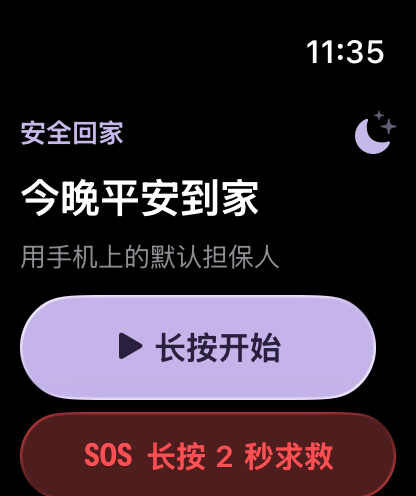

# 安全回家 · 设计说明

App 名：**安全回家**（工程、Bundle ID 仍叫 NightEscort）。口号：回家路上，有人一直在。

 

## 文件

| 文件 | 内容 |
| --- | --- |
| `AppIcon.svg` | App 图标矢量源文件：定位针里挖一弯月亮 |
| `screens/app/` | 现在代码的样子：iPhone 和手表各 8 个页面的模拟器截图（`ios/scripts/screenshots.sh` 截的） |
| `screens/watch-current-theme.png` | 最早那版手表设计（蜜桃薰衣草 · 深），现在的配色就取自它 |
| `screens/watch-all-themes.png` | 同一套布局的 4 套备选配色 |
| `screens/app-icon-options.png` | 图标备选方案（最终选了 ③ 夜间定位） |
| `watch-icons/*.svg` | 手表立体图标的矢量源文件，导出的 PNG 在 `ios/NightEscortWatch/Assets.xcassets` |

## 颜色（2026-11-18 定稿）

手机用「夜色紫金」：深紫底，主要页面左上蜜桃金、右下薰衣草两团光晕，主按钮蜜桃金，整个 App 固定深色。手表用「黑底薰衣草」：watchOS 默认的黑底，主按钮和强调色换成薰衣草。按钮、列表、图标、字体都还是苹果原生的，只换颜色。

| 名字 | 色值 | 用在哪 |
| --- | --- | --- |
| 深紫底 | `#15111F` | 手机页面和列表的底 |
| 卡片 | `#221B31` | 手机列表行、卡片 |
| 蜜桃金 | `#FFDAB9` | 手机主按钮、首页自己的头像、选中的金圈、今晚临时守护；左上光晕 |
| 薰衣草 | `#C7B8EA` | 强调色（链接、图标、进度条）、别人的字母头像、手表主按钮；右下光晕 |
| 深紫字 | `#2A1F3D` | 金色、薰衣草底上的字 |
| 求救红 | 系统红 | 只用在 SOS 和联系不上 |

代码里对应：色值在 `ios/Shared/Palette.swift`（`Brand`、`Palette`），手机 `Theme`（`NightEscort/Views/Common/Components.swift`），手表 `WTheme`（`NightEscortWatch/WatchViews.swift`）。小组件和灵动岛跟手机一样。

## 字体

全部用苹方（PingFang SC），代码里是 `.font(.pf(...))`，不用圆体。

## 手表界面（7 个）

布局统一：左上小标签、右上时间、中间一个立体图标 + 大标题、底部按钮。

1. 未登录：手机图标，「在 iPhone 上登录一下」+ 重试
2. 待机：月亮，「今晚平安到家」+ 长按开始 + 长按 2 秒求救
3. 护航中：倒计时 + 走路小人 + 进度条 + 两个数据块 + 我没事 / 到了，结束 / 结束护航 / 求救
4. 已暂停：暂停图标，「暂停到明早 HH:mm」+ 结束护航
5. 超时 / 求救：红色小标签和铃铛，「担保人正在联系你」+ 红色的我没事
6. 到家确认：小房子，「检测到你已经到家」+ 到了，结束护航 / 还没，继续
7. 提示：对话气泡 + 一句话 + 好

按钮都是系统的液态玻璃：主要操作是薰衣草着色的 `.glassProminent`（深紫字），次要操作是透明的 `.glass`，求救和超时用系统红。

## 求救（SOS）

- 手机：首页「开始护航」右边、护航面板里各有一个红色 SOS 圆钮，长按 2 秒圆环走满即发出。
- 手表：待机屏和护航中的「长按 2 秒求救」。
- 发出后所有担保人最高级别响铃，标题「XX 发起了求救」；她点「我没事」解除。
- 担保人全屏框里有「打电话给她」，只在事件进行中能看到她的号码。

## 原始设计画布

所有探索过的方案（色彩、线稿、拙趣、体能训练风、图标）都在 Claude 的设计画布里，需要由画布所有者在页面右上角 Share 里共享后，其他人才能打开。
